<div align="center">

# Ripple

**조선소 설계변경 영향도 분석 및 의사결정 지원 솔루션**

설계변경 한 건이 구매·생산·비용·일정에 미치는 영향과 **결정 기한**을 근거와 함께 한 화면에

🏆 **2026 K-조선 해커톤 본선 한국조선해양플랜트협회장상** (설계 분야) · 합성 데이터로 라이브 운영 중

[](https://ripple-ecn.up.railway.app)
[](https://github.com/Patrick-SCH03/Ripple/actions/workflows/ci.yml)
[](LICENSE)

[사용 가이드](docs/guide.md) · [기능과 역할](docs/features.md) · [코드 지도](docs/architecture.md) · [평가](docs/evaluation.md) · [API](docs/api/README.md)

</div>

---

## 왜 만들었나

- **설계변경 한 건은 여러 곳으로 이어집니다.** 판 두께 하나가 그 판의 발주, 용접으로 붙은 이웃 판, 관통 배관, 조립 중인 블록 공정까지 바꿉니다.
- **조선소 실무자는 이 연결을 엑셀로 쫓습니다.** 도면·BOM·발주대장·공정표를 사람이 오가며 추적해 시간이 들고, 놓친 영향은 재작업과 지연으로 돌아옵니다.
- **확정이 늦을수록 손실이 커집니다.** 같은 변경도 발주·블록이 어느 단계인지에 따라 비용이 달라지고, 결재를 기다리는 동안에도 날짜는 갑니다.

→ Ripple은 이 과정을 **변경 한 줄 입력 → 근거가 달린 영향 범위·변경비용·결정 기한 → 결재선 결재**로 바꿉니다.

---

## 한눈에 보기

<picture>
  <source media="(prefers-color-scheme: dark)" srcset="docs/images/diagrams/overview-dark.png" />
  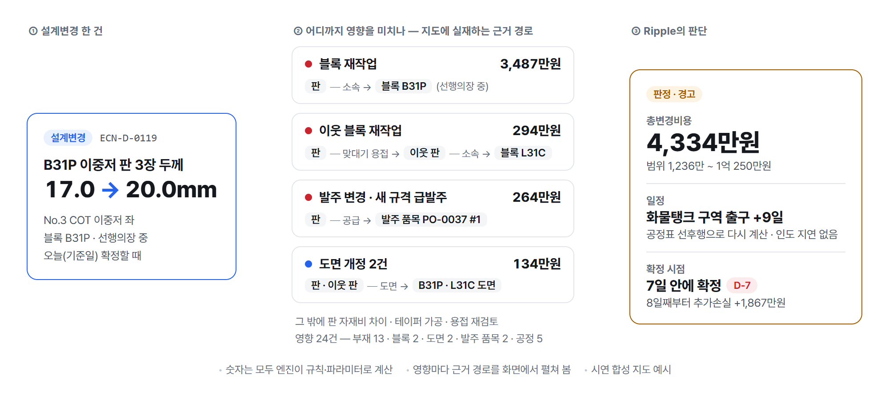
</picture>

| 알려 주는 것 | 예시 — 이중저 판 3장 두께 17 → 20mm |
|---|---|
| **영⁠향 범⁠위** | 블록 재작업·발주 변경·도면 개정에 더해, 용접으로 이어진 **이웃 블록 L31C** 같은 2차 영향까지 근거 경로와 함께 |
| **변⁠경⁠비⁠용** | **4,334만원**(범위 1,236만~1억 250만원), 비용 줄마다 이유·계산식·가정값 |
| **결⁠정 기⁠한** | **7일 안(D-7)에 확정하면 추가손실 0**, 8일째부터 블록이 선행도장 단계로 넘어가 1,867만원 증가 |
| **결⁠재** | 파트장 → 팀장 → 본부장 결재선과 **결재 올릴 기한**, 더 저렴한 대안(보강재 추가, 720만원) 권고 |

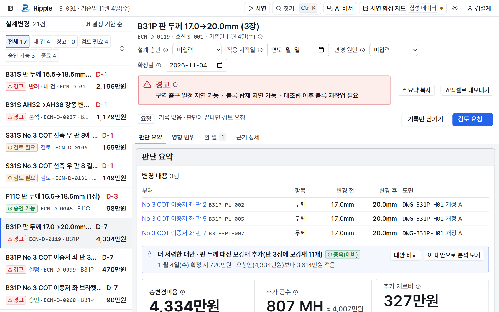

---

## 주요 기능

<table>
<tr>
<td width="50%" valign="top">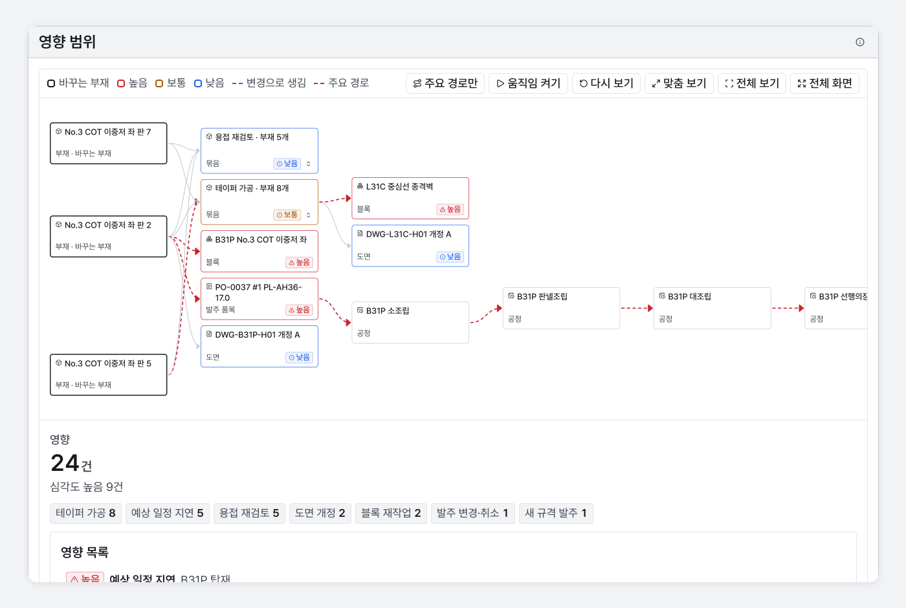<br/><b>영향 지도</b> — 바뀐 부재에서 관계를 따라 2차 영향까지, 주요 경로 강조</td>
<td width="50%" valign="top">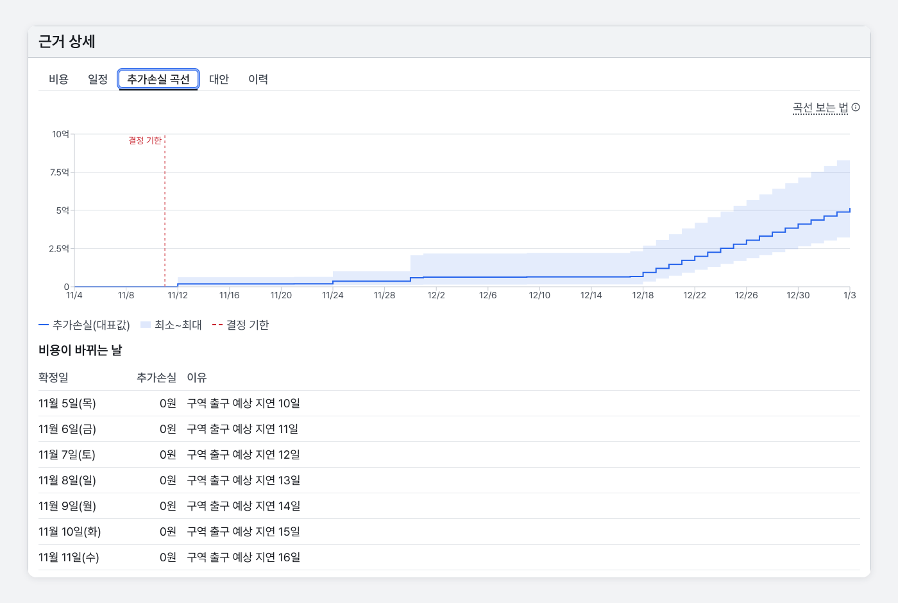<br/><b>결정 기한 · 추가손실 곡선</b> — 확정을 미룰 때 늘어나는 금액</td>
</tr>
<tr>
<td width="50%" valign="top">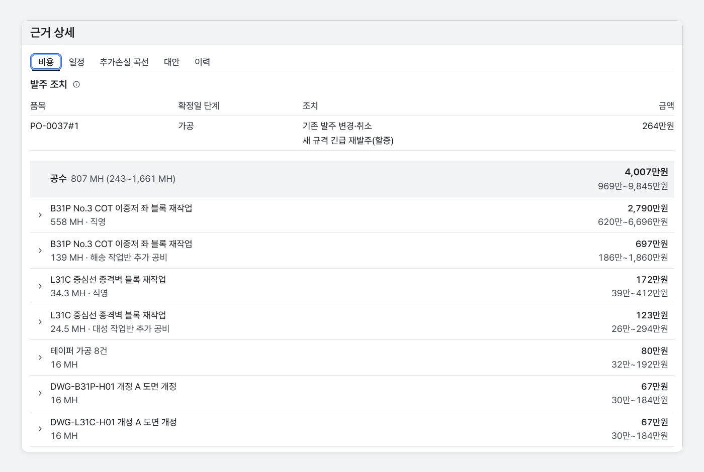<br/><b>비용 · 발주 조치</b> — 이미 발주한 품목의 조치와 비용 줄, 직영·작업반 몫</td>
<td width="50%" valign="top">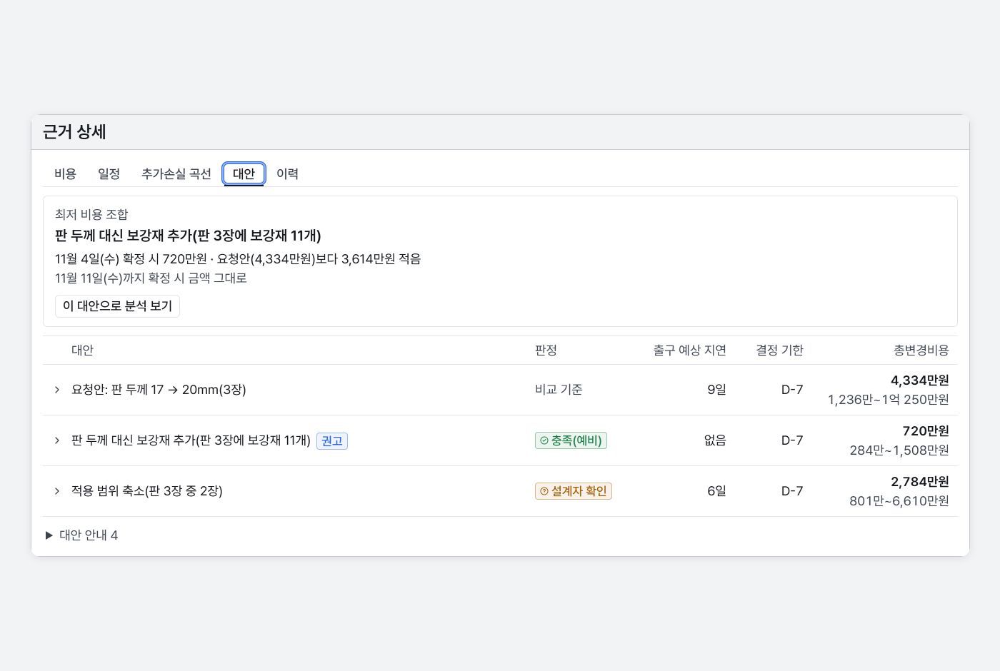<br/><b>대안</b> — 판 두께 대신 보강재 같은 더 저렴한 조합과 예비 강도 비교</td>
</tr>
<tr>
<td width="50%" valign="top">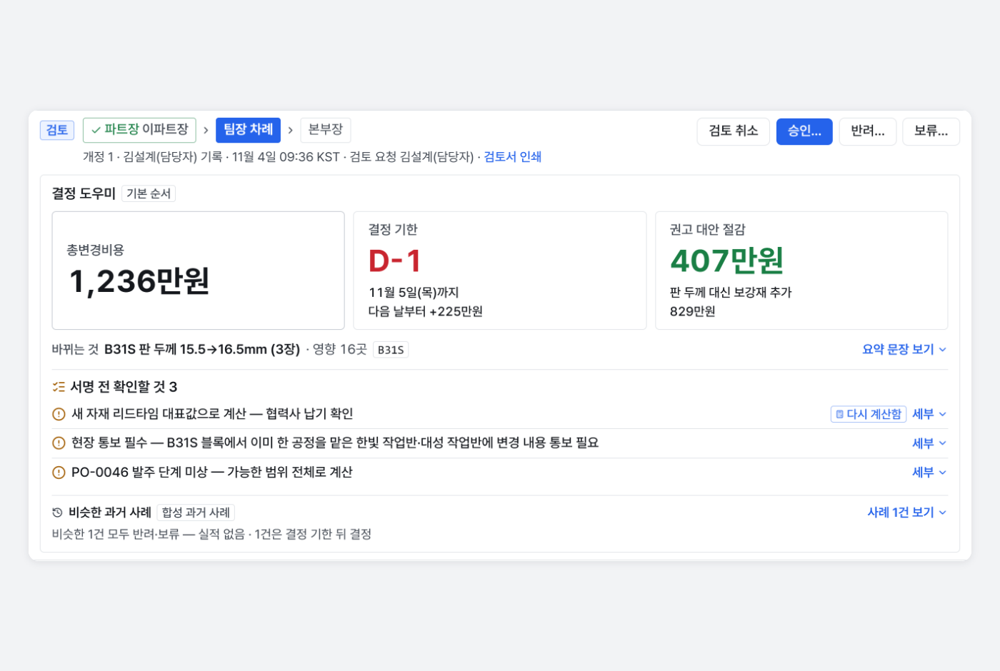<br/><b>결재 · 결정 도우미</b> — 결재선 진행과 세 줄 요약·서명 전 확인할 것</td>
<td width="50%" valign="top">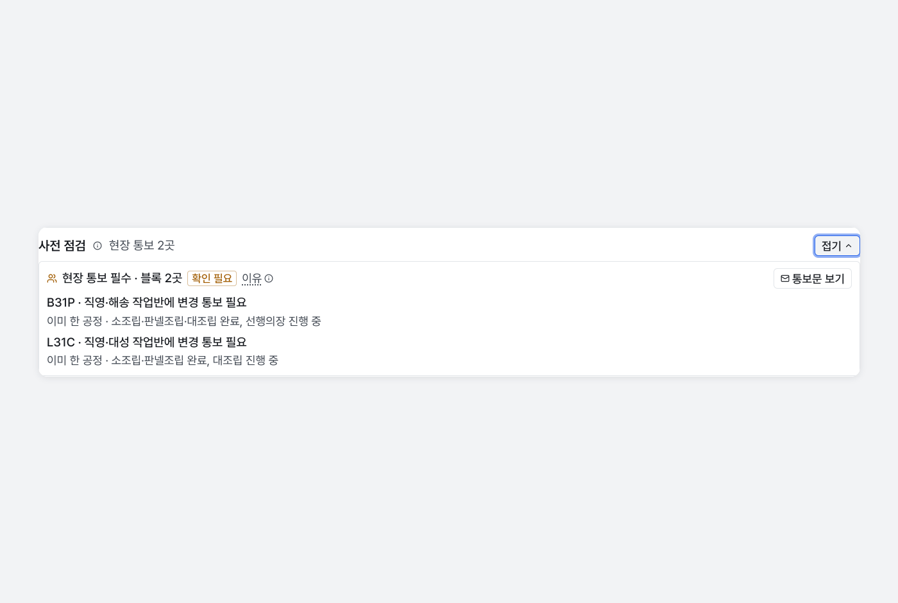<br/><b>사전 점검</b> — 현장 통보·관통부 누락 같은 6규칙, 판정·금액과 분리</td>
</tr>
</table>

- **입력**: 현장 표현 그대로 쓴 문장, 설계변경 문서, 실무 엑셀(흔한 변형·열 자동 매핑)
- **출력**: 영향 목록·비용 근거·일정(CPM)·대안 비교 엑셀, A4 설계변경 검토서
- **기록**: 바뀌지 않는 개정 → 검토 요청 → 결재(승인·반려·보류) → 실행·종료, 해시 사슬 감사 로그

기능 전체와 역할별 흐름은 [기능과 역할](docs/features.md)에 있습니다.

---

## 어떻게 동작하나

<picture>
  <source media="(prefers-color-scheme: dark)" srcset="docs/images/diagrams/flow-dark.png" />
  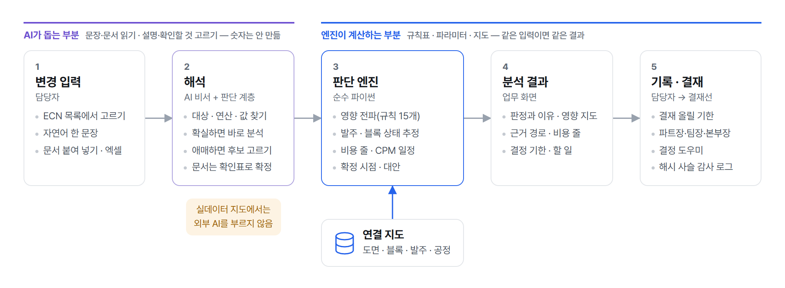
</picture>

- **조선 온톨로지와 지식 그래프** — 부재·블록·발주·공정·도면 등 **엔터티 9종**과 용접·공급·선행 등 **관계 11종**을 정해 두고, 부서별 엑셀을 같은 기준의 그래프로 만듭니다([도메인](docs/domain.md)).
- **숫자는 엔진만 만듭니다** — 규칙 15개로 영향을 퍼뜨리고 비용 줄·CPM 일정·추가손실 곡선을 계산합니다. 같은 입력이면 같은 결과가 나옵니다([엔진 명세](docs/engine.md)).
- **AI는 돕기만 합니다** — 못 읽은 문장 다시 쓰기, 설명 고르기, 문서 항목 추출만 맡고 숫자는 쓰지 못합니다. 그래프에서 확인된 사실만 넘기고 답을 다시 대조합니다([외부 AI](docs/input.md#외부-ai)).
- **실데이터는 밖으로 나가지 않습니다** — 실데이터 모드에서는 외부 AI를 부르지 않고, 같은 Docker 이미지를 사내 서버에 설치할 수 있습니다([배포](docs/operations.md#배포)).

<details>
<summary><b>연결 지도</b></summary>

도면(설계 BOM) → 블록(생산 BOM) → 발주 품목(구매) → 공정(시공)을 키로 잇습니다. 지도에서 끊긴 연결은 '확인 필요'로 표시합니다.

<picture>
  <source media="(prefers-color-scheme: dark)" srcset="docs/images/diagrams/map-dark.png" />
  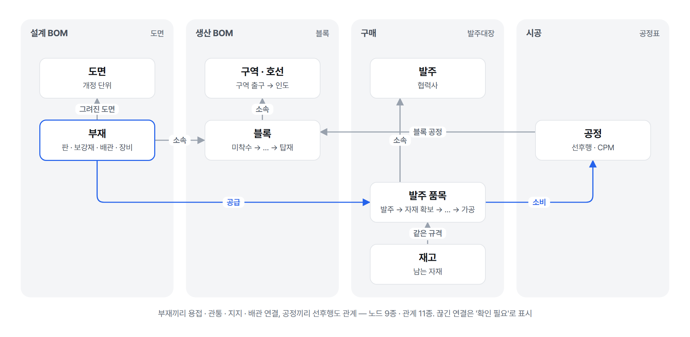
</picture>

</details>

---

## 서비스 아키텍처

<picture>
  <source media="(prefers-color-scheme: dark)" srcset="docs/images/diagrams/architecture-dark.png" />
  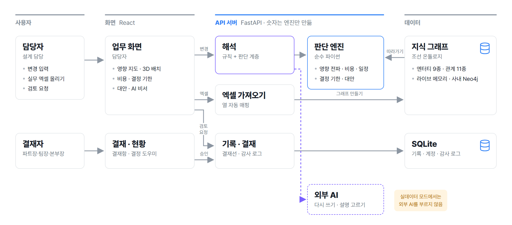
</picture>

- **판단 엔진**만 숫자를 만들고, 외부 AI는 문장 다시 쓰기·설명 고르기만 맡습니다. 실데이터 모드에서는 외부 AI를 부르지 않습니다.
- **지식 그래프**는 라이브에서 메모리로, 사내 설치본에서는 Neo4j로 씁니다.
- 화면과 API는 **Docker 이미지**로 배포되고, 같은 이미지를 사내 서버에 그대로 설치할 수 있습니다.

---

## 측정된 결과

**합성 지도(시드 20261020)** 로 잰 값입니다. 실제 조선소 데이터나 현장 사용으로 잰 값은 아직 없습니다.

| 지표 | 값 |
|---|---|
| **영⁠향 찾⁠기**(정답 30건) | 기대 영향 **136/136** · 재현율·정밀도 1.000 |
| **조⁠회 방⁠식 대⁠비** | 엔터티 F1 0.657 → **1.000**, 조회로는 안 나오는 2차 영향 **51/51** |
| **비⁠용·일⁠정 계⁠산**(관문 13건) | 비용 줄·금액(±1%)·구역 출구·인도 지연·판정 **13/13 일치** |
| **근⁠거 완⁠전⁠성**(관문 43건) | 영향 근거 경로 **214/214** · 비용 줄 근거 **99/99** |
| **분⁠석 시⁠간** | 1건 평균 **0.11초**(설계변경 100건), 블록 150개 지도 평균 0.30초 |
| **엑⁠셀 열 맞⁠춤** | **98.3%**(변형 엑셀 1,500파일) |
| **성⁠질 검⁠사** | 파이썬 2,227개 · 화면 706개, mypy strict 오류 0 |

정답은 엔진 코드를 보지 않은 계산자가 명세·규칙표·지도만으로 만들었습니다. 그래서 1.000·13/13은 **엔진이 자기 명세를 그대로 따른다**는 뜻이고 현장 정확도를 뜻하지 않습니다. 측정 방법과 아직 재지 않은 것은 [평가 기준과 측정](docs/evaluation.md)에 있습니다.

---

## 기술 스택

<table>
<tr>
<td align="center" width="33%">

### 판단 엔진 · AI


**Pydantic 2** 계약 · **순수 파이썬 엔진**<br/>
전파 · 비용 · CPM 일정 · 사전 점검<br/>
로컬 판단 계층 · Claude API

</td>
<td align="center" width="33%">

### Back-end


**FastAPI** · uvicorn<br/>
**SQLite** 기록·감사 로그<br/>
**Neo4j** Community(사내 설치본)

</td>
<td align="center" width="33%">

### Front-end


**React 19** · TypeScript · Vite<br/>
**React Flow** + dagre · shadcn/ui<br/>
Recharts · Three.js

</td>
</tr>
</table>

<div align="center">

**CI/CD** ·  GitHub Actions 검사 · Docker 이미지 → Railway

</div>

---

## 프로젝트 구조

```
├── ripple/
│   ├── contracts/          # Pydantic 계약 — 도메인·분석·결과·기록·결재
│   ├── engine/             # 판단 엔진 — 전파 규칙·상태 추정·비용·CPM 일정·확정 시점·판정·사전 점검
│   ├── decide/             # 판단 계층 — 확률 보정·문턱 검정·되묻기
│   ├── nl/ agent/ intake/  # 자연어 해석 · AI 비서 대화 흐름 · 문서 접수 확인표
│   ├── explain/ llm/       # 설명·알림 렌더러 · 외부 모델 어댑터(실데이터 모드 차단)
│   ├── records/ auth/      # 결재 상태 기계·결재선·감사 사슬 · 로그인·세션·구성원
│   ├── brief/ cases/       # 결정 도우미 · 합성 과거 사례·NCR
│   ├── graph/ ingest/ store/  # 지도 저장소(메모리·Neo4j) · 엑셀 가져오기 · SQLite 저장소
│   ├── generator/ eval/    # 합성 지도·설계변경 생성기 · 관문 채점·평가 지표
│   └── api/                # FastAPI 앱과 경로
├── web/                    # 소개·로그인·업무·결재 화면 (React)
├── rules/ params/          # 전파 규칙표·현장 용어 · 비용·판단 파라미터(값마다 근거)
├── eval/                   # 관문 손 계산 사례·평가 보고서
├── docs/                   # 명세·가이드·평가·OpenAPI
├── tests/                  # 성질 검사(서버·키 없이) · Neo4j 통합 검사
└── scripts/                # 합성 데이터 생성·평가·OpenAPI 도구
```

| 문서 | 내용 |
|---|---|
| [사용 가이드](docs/guide.md) · [기능과 역할](docs/features.md) | 화면 쓰는 법 · 기능 전체·역할별 흐름 |
| [코드 지도](docs/architecture.md) · [API](docs/api/README.md) | 패키지 역할·요청 흐름 · 경로·권한 |
| [엔진](docs/engine.md) · [도메인](docs/domain.md) · [입력](docs/input.md) · [기록·결재](docs/records.md) | 계산·상태·해석·결재 명세 |
| [평가](docs/evaluation.md) · [평가 보고서](docs/eval_summary.md) · [데이터](docs/data.md) | 측정 방법·결과 · 합성 데이터·파라미터 근거 |
| [운영](docs/operations.md) | 서비스 설정·배포 |

---

## 개발 컨벤션

커밋 메시지 규칙, 브랜치 전략, CI 구성은 **[CONTRIBUTING.md](CONTRIBUTING.md)** 를 참고하세요.

---

## 주의

- 해커톤 출품용 프로토타입입니다. **가상 수에즈막스 원유운반선의 합성 데이터**로 개발했고, 실제 회사·호선 데이터가 아닙니다.
- 기술적으로 승인된 설계변경의 구매·생산·비용·일정 영향을 봅니다. **설계 적합성 판단은 범위 밖**이고, 대안 강도 비교는 예비 비교로 선급 판정이 아닙니다.
- 비용 파라미터는 공개 통계·공시·문헌과 가정에서 나온 값이며, 값마다 근거와 상태(근거 있음 / 가정 / 현업 확인)를 [`params/`](params/)에 적었습니다.
- 결정 도우미의 과거 사례와 NCR은 **시연용 합성 자료**이고 실제 이력이 아닙니다.

## 라이선스

[MIT](LICENSE)
