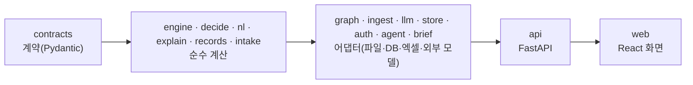

# 코드 지도 — 어디에 무엇이 있고, 무엇을 고칠 때 어디를 보나

새로 들어온 사람(사람·AI 도구)이 저장소를 처음 열었을 때 길을 잃지 않게 하는 문서다. 계산의 뜻은 각 명세
(`docs/engine.md`(전파) · `docs/engine.md`(비용·일정) · `docs/domain.md` · `docs/engine.md`(대안) · `docs/input.md`(엑셀 양식) ·
`docs/records.md` · `docs/operations.md`(서비스) · `docs/input.md`(문서 접수))가 정하고, 여기서는 **코드가 어디에 있는지**만 적는다.

## 1. 레이어와 의존 방향

- 안쪽은 바깥을 모른다. 허용 표는 `tests/checks/layers.py`의 `ALLOWED`이고 어기면 검사가 실패한다(새 패키지를 만들면 이 표에 먼저 적는다).
- **순수 계산 레이어**(`contracts` · `engine` · `decide` · `nl` · `explain` · `records` · `intake`)는 파일·네트워크·DB·LLM 모듈을 import하지 않는다(같은 검사).
- 생성기(`generator`)는 엔진을 보지 않는다 — 숨긴 실제 비용 모델이 엔진과 같은 답을 베끼지 않게.
- 화면은 계산하지 않는다. 숫자는 모두 분석 결과 필드에서 오고, `web/src/lib`의 순수 함수가 포맷·정렬·표시만 한다(vitest).

## 2. 패키지 한 줄씩

| 경로 | 하는 일 | 명세 |
|---|---|---|
| `ripple/contracts` | 모든 레이어가 쓰는 계약(요청·결과·지도·비서·가져오기·계정·기록). 분석 결과는 `result/`(어휘·금액·영향·비용·일정·확정 시점·대안·판정·영향 보고·근거·분석 결과 모듈), 비서는 `assistant/`(초안·대화 차례). `base.py`의 `CONTRACT_VERSION` | 각 모듈 머리 |
| `ripple/engine` | 지도 색인 → 요청 검증 → 변경 후 보기 → 전파 규칙 → 상태(발주·블록 단계) → 비용 → 일정(CPM) → 확정 시점 곡선·마감일(`timing/`: 겉 클래스 `evaluator` · 평가 문맥 `context`(`EvalContext`·`DayScenario`) · 규칙 ID `rule_ids` · 하루 평가 `day` · 일정 조정 `adjust`·`ships` · 인도 `delivery` · 영향 `impacts` · 곡선 `curve` · 보류 권고 `hold` · 일정 위험 `risk` · 선상 설치 `onboard`) → 판정, 대안(`alternatives/`), 도면 → 블록 → 발주 품목 → 공정 연결 추적(`trace.py`), 설계 승인 상태·적용 시작일 메모(`analyze.py`) | engine(전파·비용·일정·대안) · domain |
| `ripple/engine/precheck` | 설계변경 사전 점검(1.32.0): 분석 결과를 다 만든 뒤 붙이는 판정과 분리된 확인 항목 — 문맥 `scope`(변경 후 보기·범위 블록·지도에 있는 정보) · 설치 시점·새 스풀 서포트 `install` · 관통부 정합 `penetration` · 블록 경계 연결·분야 간 도면 `links` · 현장 공유 `field` · 문장 `text` | engine(사전 점검) |
| `ripple/decide` | 판단 계층: 온도 보정·문턱 검정·되묻기 집합·점수기 | input(판단 계층) |
| `ripple/nl` | 문장 → 변경 초안(규칙 기반 해석·값 정규화·대상 후보). 참조 추출 `refs`(별칭 `aliases`·번호 `part_numbers`), 값 `values`(`value_exprs`), 초안 채우기 `draft`(`filler`·`fill_ops`) | input(판단 계층·외부 AI) |
| `ripple/explain` | 설명·알림 초안·공식 메일(글 템플릿 + 수치 블록 렌더러, `mail.py`), E4 검출기, 현장 통보문(작업반 메일) 번역 초안(1.36.0: 언어별 문장 `translate.py` · 용어 대역 `terms.py`, 데이터 `params/glossary_v1.yaml`, 외부 AI 없음) | input(외부 AI) · records(통보) 6절 |
| `ripple/records` | 결재 상태 기계(`flow.py`) · 결재선·무비용·결재 소요(`approval.py`) · 감사 사슬(`chain.py`) · 결재·현황 지표(`metrics.py` — 기록 한 건 값·입력 `recorded.py`, 성과 `performance.py`, 순수) | records |
| `ripple/intake` | 문서 접수 순수 계산: 머리 읽기·규칙 분할(`segment`) · AI 인용 검증·합치기(`build`) · 조각 → 확인표 항목·문제(`assemble`) · 항목 사이 검사(`checks`) · 확정 검증(`confirm`) · 원문 번호 → 기록 ID(`ecn_ref`) | input(문서 접수) |
| `ripple/agent` | AI 비서 대화 흐름(`flow.py` 겉 클래스 + 경로 `routing` · 값 반영 `overrides` · 답 `answers` · 응답 `replies`, 되묻기·확인·분석·사유 기록, 초안만 모드) · 문서 접수 조율(`intake.py`: 제안 보관·확정, AI 항목 뽑기 `intake_extract` · 수정 기록 행 `intake_records` · 요청자 신원 `intake_types`) | input(외부 AI·문서 접수) |
| `ripple/llm` | 외부 모델 어댑터(Claude)·작업별 경로, 실데이터 모드 차단 | input(외부 AI) |
| `ripple/brief` | 결정 도우미(1.31.0): 기록 본문(분석 결과) → 세 줄 요약(`lines`, 규칙 우선순위 고정) · 서명 전 확인할 것 후보(`checks`) → 고르기(`pick`, 규칙 순서 또는 AI — 확인할 것의 선택·순서만, 기록 본문이 합성일 때만) → 검사(`audit`, 줄 순서·글 속 숫자 출처) · 조립(`build`, 과거 사례는 받은 `CaseFinder`). 표기 `text`. 다시 계산하지 않는다 | records(기록·결재) 13절 · input(외부 AI) |
| `ripple/graph` | 지도 저장소(메모리·Neo4j 고정 템플릿)·지도 파일·부분 그래프 | domain |
| `ripple/ingest` | 엑셀 가져오기: 통합 문서 읽기(`workbook`) → 표 찾기·열 판단·제안(`tables`·`columns`(`file_columns`·`column_features`)·`proposal`·`mapping`) → 셀 값 해석(`values`) → 표·행 읽기(`sheet_tables`·`rows`, 표 타입 `table_types`) → 시트 정합(`integrity`) → 조립(`build`), 내보내기(`export`)·변형 생성(`variants`). 분석 결과·결재 대장 엑셀 내보내기(`out_analysis`·`out_analysis_sheets`·`out_ledger`, 표 쓰기 `out_table`, 이름표 `out_labels` — 값은 결과 필드 그대로) | input(엑셀 양식) |
| `ripple/store` | 파일 저장소: 지도(`snapshots`)·계정·세션(`accounts`)·기록·감사(`records/`, SQLite: 형식 판 `schema` · 기록 ID·투영·요약 `identity` · 행 접근 `rows` · 쓰기 `writes` · 읽기 `reads` · 감사 `audit` · 확인 `verify`)·수정 기록(`corrections`, SQLite)·기록 비우기·시연 기록 바꿔 끼우기(`reset`, 자동 보관 14개)·기록 파일 문(`gate`: 바꿔 끼우는 동안 연결을 막음)·메모리 TTL 보관(`ttl`) | records · operations(서비스) · input(문서 접수) |
| `ripple/config` | 설정(`settings`)·규칙표·파라미터 읽기(`loaders`)·파일 바꿔 끼우기(`files.replace_file` — os.replace를 Windows의 짧은 잠금(백신·색인)에 1초 안에서 다시 시도, 저장소·사용량 장부가 모두 거침)·원자적 쓰기(`files.write_atomic` — 고유 임시 파일 → 디스크에 내림 → 바꿔 끼우기, 실패해도 임시 파일 정리, 저장소·사용량 장부) | operations |
| `ripple/auth` | 비밀번호 해시·세션·실패 제한(`service`·`throttle`), 사람·아이디 규칙(`principal`), 구성원 관리(`members`, 계정 도우미 `accounts`), 빠른 로그인 고정 계정(`quick`, 시연 배포 전용) | operations(서비스) |
| `ripple/cases` | 결재할 때 보는 비슷한 과거 사례: 합성 묶음(생성기 세계를 다시 만들어 개발 분할 재료 · 예측은 엔진 · 실적은 숨긴 실제 모델 · 결정 종류·시점만 시드 가정, `synthetic`) · 실데이터 묶음(실적 있는 종료 기록, `real`) · 비슷한 정도(`features`) · 교훈·요약 템플릿(`notes`) · 찾기(`library` `find_cases`) · 지도 ID 캐시와 백그라운드 만들기(`shelf` `CaseShelf`) · 합성 NCR 묶음(`ncr`, 생성기 설정·씨앗 + `params/ncr_v1.yaml`, 합성 모드 전용·건수만) | records(합성 과거 사례·합성 NCR) |
| `ripple/generator` · `ripple/eval` | 합성 지도(`structure/`: 선체·배관·조립)·설계변경·문장 생성(`nl/`), 시연 합성 지도의 블록 사이 관계 보강(`relations`, 설정 `generator/demo_map.yaml`), 숨긴 실제 비용 모델(`actuals/`, 항목 금액 몫 합치기 `amounts`) · 관문 사례(`gate_inputs`·`gate_boundary`(문맥 `Boundary`)·`cost_gate_inputs`·`alt_gate_inputs`, 공통 타입 `gate_types`)·지표, 숨긴 모델 대비 E2a 비용(`cost_accuracy`)·E2' 일정(`schedule_accuracy`)·E7 결정(`decision_agreement`), 근거 링크 완전성·비용 근거 지표(`evidence_metrics`), E9 문서 접수 합성 문서·채점(`intake_docs`) | data(생성기) · gate_cases · eval_summary · evaluation |
| `ripple/eval/backtest` | 과거 설계변경 백테스트: 사례 양식(엑셀 한 행 = 한 사례, `case`·`workbook`) → 최소 지도·요청(`scope`·`plan`·`world`·`build`, 빈 칸은 `defaults.yaml` + 가정) → 엔진 예측과 실제 비교(`compare`·`summary`) → 결과 xlsx·md(`tables`·`report`, 원문 칸 없음). 명령 `scripts/backtest.py` | backtest |
| `ripple/api` | 앱 조립(`app.py`), 권한(`security.py`), 결정 도우미 서비스(`brief.py`: 데이터 모드 경계·기억·같은 지도·같은 판일 때 대안 포함 계산 `recorded_alternatives`)·과거 사례 연결(`past_cases.py`: 기록이 깔린 지도 기준, 프로세스에 하나인 합성 묶음 선반)·합성 NCR 연결(`ncr.py`: 프로세스에 하나인 묶음, 데이터 모드에 따른 사전 점검 건수·요약), 작업 공간 세대·가져오기 상태(`workspace.py`, 도우미 `generation`·`pending_imports`(가져오기·상태 올리기가 같이 쓰는 대기·확정 기억 `PendingImports`)·`snapshot_info`·`updated_maps`·`mapping_memory`·`workspace_errors`), 기록 서비스(`records.py`), 합성 시연 기록 시드(`demo_seed.py` 채우는 법, `demo_daily.py` 언제 — 실시간 세계는 KST 날마다·시드 판이 바뀐 배포 뒤 자동으로 새로 채움, 각본 `demo_plan.py`), 경로(`routes/`) | operations(서비스) · records |
| `web/src` | 화면(아래 4절) | DESIGN.md |

## 3. 요청이 흐르는 길

- **분석**: `POST /api/analyses`(`routes/analyses.py`) → 요청이 시작될 때 잡은 작업 공간 세대(`api/workspace.get_workspace`)의 지도 색인으로 `engine/analyze.analyze` → `AnalysisResult`.
  - 화면은 `state/useAnalysisSession.ts`.
- **AI 비서**: `POST /api/assistant/turns`(`routes/assistant.py`) → `agent/flow.Assistant.turn` → `nl`(해석) · `decide`(되묻지 않고 바로 분석/되묻기) · `llm`(합성 데이터일 때만 보조) → 분석 → `explain`(설명·알림).
  - 화면은 `state/useAssistant.ts`·`components/assistant`.
- **엑셀 가져오기**: `POST /api/imports…`(`routes/snapshots.py`) → `Workspaces.stage → propose → submit → confirm`(`api/workspace.py`) → `ingest`(위 2절 순서) → `store/snapshots.py` → 작업 공간 세대 교체.
  - 화면은 `components/workspace`(ImportDialog·ColumnReview).
- **기록·결재**: `POST /api/records` · `POST /api/ecns/{id}/actions`(`routes/records.py`) → `api/records.py`(다시 계산 → 확인 목록 → 지도 전환 잠금 안 커밋) → `records/flow.py`(규칙) + `store/records/`(한 트랜잭션·감사 사슬).
  - 계산 판 대조는 `api/records.py` `same_version_of`(엔진 `analysis_versions`와 같은 판 묶음)를 저장소 행동·상세 읽기에 넘긴다.
  - 화면은 `state/useRecords.ts`·`components/records`.
- **결정 도우미**: `GET /api/ecns/{id}/brief`(`routes/brief.py`) → 진행 중 검토 개정의 기록 본문 → `api/brief.BriefService`(기록 본문의 데이터 모드로 `Guarded`, 같은 기록·업무상 오늘·AI 경로면 기억) → `brief.build_brief`(과거 사례는 `api/past_cases.finder_for` → `cases.find_cases`, 합성 묶음은 작업 공간이 기본 지도를 깔 때 `CaseShelf.prepare`).
  - 화면은 `components/records/brief`(결재 띠 안, 팀장 + 검토·보류 중).
- **문서 접수**: `POST /api/intake/proposals`(`routes/intake.py`) → `agent/intake.IntakeService.propose` → `intake.segment`(머리·규칙 분할) + `llm`(합성 데이터일 때만 항목 뽑기) → `intake.build`(인용 검증·넓히기·합치기) → `intake.assemble`(해석기로 다시 읽기·지도 대조·문제) → 제안 보관.
  - 확정 `POST /api/intake/confirmations` → `intake.confirm`(서버 재검증) → 분석 → 수정 기록(`store/corrections.py`).
  - 화면은 `components/intake`(IntakeDialog·IntakeItemCard·HandoffPanel)·`lib/intake.ts`.
- **로그인**: `routes/auth.py`·`routes/accounts.py` → `auth/` → `store/accounts.py`, 권한 표는 `contracts/auth.py`, 경로별 권한은 `api/security.py`.
  - 화면은 `state/useSession.ts`·`pages/login`.

## 4. 화면 구조(`web/src`)

| 경로 | 하는 일 |
|---|---|
| `main.tsx` · `Root.tsx` | 경로(소개 `/` · 로그인 `/login` · 업무 `/app` · 판단 리포트 `/app/report/<ECN>/<개정>`)와 로그인 상태에 따른 화면 고르기(로그인 전이면 그 경로로 돌아오게) |
| `Workbench.tsx` | 업무 화면 조립: 목록 · 상세 · 비서 세 칸, 명령 팔레트, 지도 메뉴, 결재 연결. 동작은 `state/`의 훅(연 차례 `useOpenOrder` · 기록 링크 `useRecordLinks` · 비서 칸 `useAssistantDock` · 근거 `useEvidence` · 상태 갱신 `useStatusUpdate` · 분석 기준 `useBasis` · 팔레트 `useCommandPalette`) |
| `api/` | `client.ts`(`api` 객체 조립) · `http.ts`(요청 규칙·작업 공간 토큰·인증 세대) · 영역별 요청(`workspace`·`imports`·`analysis`·`assistant`·`records`·`intake`·`manage`·`account`) · `types.ts`·`schema.d.ts`(OpenAPI에서 만든 타입) |
| `state/` | 화면 상태 훅: 로그인(`useSession`) · 작업 공간(`useWorkspace`) · 분석(`useAnalysisSession`, 다시 분석 `useDraftEdits`) · 비서(`useAssistant`) · 결재(`useRecords`, 목록 `useEcnList` · 상세 `useEcnDetail`) |
| `lib/` | 순수 함수(포맷·정렬·문구·행동 계산 · 일정 요약 `schedule` · 리포트 뷰 모델 `report`) — 각각 `*.test.ts`. 여러 곳이 같이 쓰는 DOM id는 `domIds`, 시연 시나리오(선언형 단계·셀렉터)는 `demoScenarios`·허용 목록·번호는 `demo` |
| `components/` | `ecn`(목록·줄·결재 대기·기록된 다른 설계변경) · `detail`(상세·탭·영향 지도 `RipplePanel`·연결 추적 `TracePanel`·할 일 `ActionsSection`(조치 `TodoList` + 현장 상태 확인 `StateBasisCard`)·발주 조치 `PoActions`) · `records`(결재 띠·결정 대화상자·이력 · 결정 도우미 `brief/`(카드 `DecisionBriefCard`·과거 사례 `PastCasesList`·불러오기 `useDecisionBrief`, 표시 계산 `lib/brief`)) · `graph`(영향 지도 그래프) · `graph3d`(3D 배치, 열 때만 불러옴) · `assistant` · `intake`(문서로 넣기 확인표·비서로 넘기기) · `workspace`(지도·가져오기, 단계·문구 `importDialog/steps`·`text`) · `common`(용어 설명 `TermInfo`·파일 고르기 `useFilePick`·`FileInput`) · `account`(구성원·감사·AI 호출 기록) · `shell`(위 막대·팔레트) · `demo`(위 막대 '시연' 단추: 메뉴 `DemoMenu` · 실행기 `runScenario`(기다림 → 스크롤 → 강조 → 실제 단추 누름) · DOM 조작 `demoDom` · 안내 띠 `DemoBand` · 강조 테두리 `DemoRing` · 멈춤 조건 `useDemoRunner`, 넓은 화면 전용) · `ui`(shadcn 부품) |
| `pages/` | 소개(예시는 엔진 출력 `example.json`, 날짜만 오늘로 `onDay`)·로그인 화면, 설계변경 검토서(판단 리포트, `pages/report`: 인쇄용 A4 세로 문서 — `Report`가 절 부품(`ReportHeader`·`ReportSummary`·`ReportTables`·`ScheduleSection`·`ReportRecord`, 중량 변화는 `components/detail/WeightChange`)을 차례로 놓음, 숫자는 기록 본문을 `lib/report.ts`로, 문서 전용 값(머리·핵심 수치 표·영향 범위·결재란·쪽 머리)은 `pages/report/sheet.ts`), 결재·현황(`pages/manage`: 팀장 첫 화면 — 결재함·현황·성과·관리, 데이터는 `state/useManage.ts`, 표시는 `lib/manage.ts`) |

## 5. 자주 하는 일 → 어디를 고치나

| 할 일 | 고칠 곳 | 같이 할 것 |
|---|---|---|
| 전파 규칙 추가·수정 | `rules/propagation.yaml`, `ripple/engine/rules/` | `docs/engine.md`(전파), `tests/checks/propagate.py`, 1단계 관문 회귀 |
| 비용 항목·단가 | `params/cost_v1.yaml`, `ripple/engine/cost/` | `docs/engine.md`(비용·일정), `tests/checks/cost.py`·`cost_detail.py`, 2단계 관문 |
| 계약 필드 추가 | `ripple/contracts/*.py`, `CONTRACT_VERSION` | `uv run python scripts/export_openapi.py` → `cd web && npm run gen:api` → `api/client.ts` 타입 별칭(검사 `api`가 OpenAPI 최신 여부를 본다) |
| 새 API 경로 | `ripple/api/routes/*.py` + `app.py`에 등록, 권한은 `security.py` | `tests/checks/auth_api.py`의 권한 행렬(`MATRIX`)에 경로 추가 — 빠지면 검사 실패 |
| 엑셀 양식 열 | `ripple/ingest/template.py`(양식 단일 출처) | `docs/input.md`(엑셀 양식), `tests/checks/ingest.py`·`columns.py` |
| 결재 규칙 | `ripple/records/flow.py`(서버) + `web/src/lib/records.ts`(같은 규칙으로 단추·이유) | `docs/records.md`(기록·결재) 3절, `tests/checks/records.py`의 정답표, `records.test.ts` |
| 역할 권한 | `ripple/contracts/auth.py`(`ROLE_PERMISSIONS`, 빠른 로그인은 `QuickRole` 담당자·파트장·팀장·본부장) · `ripple/api/security.py` · `ripple/records/flow.py`(행동별 권한) · `ripple/records/approval.py`(역할 → 결재 단계) · 화면 `web/src/lib/account.ts`(`ROLE_LABEL` — admin = 팀장, part_lead = 파트장, executive = 본부장) | `docs/operations.md`(서비스) 2절, `tests/checks/auth_api.py`(권한 행렬)·`manage.py` |
| 결정 도우미 문장·확인할 것 | `ripple/brief/`(`lines`·`checks`·`text`) · 검사 `audit` · AI 작업 `params/llm_v1.yaml`(`brief`) · 화면 `web/src/components/records/brief/`·`lib/brief.ts` | `docs/records.md`(기록·결재) 13절, `DESIGN.md` 13절, `tests/checks/brief.py`, `web/src/lib/brief.test.ts` — 문장 템플릿을 바꾸면 검사 함수의 이름·숫자 규칙도 본다 |
| 결재·현황 지표 | `ripple/records/metrics.py`(`overview`) · `ripple/store/records/reads.py`(`overview_inputs`) · `ripple/api/routes/manage.py` · `web/src/pages/manage/` | `docs/records.md`(기록·결재) 11절, `DESIGN.md` 15절, `tests/checks/manage.py`, `web/src/lib/manage.test.ts` |
| 실적(예측 대비) | `ripple/contracts/outcomes.py` · `ripple/store/outcomes.py`(덧붙이기만, `outcomes.sqlite3`) · `ripple/api/routes/manage.py` · `metrics.py`(`outcome_summary`) · `web/src/components/records/OutcomeLine.tsx` | `docs/records.md`(기록·결재) 11절, `tests/checks/manage.py` |
| 저장 계약(기록 본문·감사 줄) | `ripple/contracts/records.py`·`result/` — 더하는 필드는 기본값이 있게 | `tests/checks/records_compat.py`(옛 판 저장소 고정 파일 `tests/compat/records_contract_1.17.0.sql`을 새 코드로) |
| 상태 갱신(확인·상태 올리기) | `ripple/contracts/updates.py` · `ripple/engine/updates.py`(적용·날짜 규칙) · `ripple/store/updates.py`(갱신 기록) · `ripple/ingest/status.py`·`ripple/api/status_imports.py`(바뀌는 시트만) · `ripple/api/routes/updates.py` · `web/src/components/detail/StateBasisCard.tsx` | `docs/domain.md` 12절, `docs/input.md`(엑셀 양식) 5절, `tests/checks/updates.py`·`updates_api.py`·`status_import.py`, `web/src/lib/stateBasis.test.ts`·`mapDiff.test.ts` |
| 판단이 걸린 상태·자료 날짜 | `ripple/engine/basis.py`(`AnalysisResult.state_basis`) · `ripple/engine/freshness.py`(`SnapshotList.freshness`) | `docs/domain.md` 12절, `tests/checks/state_basis.py`·`updates.py` |
| 열 매핑 기억 | `ripple/ingest/fingerprint.py`(파일 모양 지문) · `ripple/store/mappings.py` · `Workspaces.with_remembered` | `docs/input.md`(엑셀 양식) 4절, `tests/checks/mapping_memory.py`·`import_memory.py` |
| 일정 위험(리드타임 범위 끝) | `ripple/engine/cost/demand.py`(배율·올림) · `engine/timing/risk.py` · `analyze.py` | `docs/engine.md`(비용·일정) 6-6, `tests/checks/schedule_risk.py`·`contracts.py`, `web/src/lib/schedule.test.ts` |
| 설계 승인 상태·적용 시작일 | `ripple/contracts/change.py`(`DesignStatus`·`Effectivity`) · `engine/verdict.py`(승인 전 이유) · `contracts/identity.py`(분석 ID) · `web/src/lib/request.ts` | `docs/domain.md` 13절, `tests/checks/ecn_trace.py`, `web/src/lib/request.test.ts`·`records.test.ts`(기록 비교) |
| 변경 원인 허용 지연(선주 요청) | `ripple/contracts/identity.py`(`permissible_delay`·옛 판 ID) · `ripple/engine/timing/delivery.py`(지체상금 대신 노출 금액) · `engine/verdict.py` · 숨긴 모델 `ripple/generator/actuals/` · `web/src/lib/summary.ts`(인도 카드) | `docs/engine.md`(비용·일정) 4-6, `docs/domain.md` 14절, `tests/checks/onboard.py`·`ecn_trace.py`, 2단계 관문 G2-012 |
| 블록 재작업(PE·난이도 계수·작업반 추가 공비 줄·도장 뒤 고정 항목 C-04, 1.32.0) | `ripple/engine/cost/rework_block.py`(공정 몫·수행 주체 단가·줄 나누기·C-04) · `cost/difficulty.py`(난이도 계수) · `cost/rework.py`(블록별 중량) · 숨긴 모델 `ripple/generator/actuals/work.py`(같은 식) · `params/cost_v1.yaml`(`difficulty.*`·`after_paint.*`·`labor_rate_per_hour.crew`) | `docs/engine.md`(비용·일정) 4-4·4-4-1·4-4-2, `tests/checks/rework.py`·`cost.py`·`actuals.py` |
| 지연 파급 비용(총액 밖, 1.32.0) | `ripple/engine/delay.py` · 계약 `ripple/contracts/result/delay.py` · `params/cost_v1.yaml`(`delay_ripple.*`) | `docs/engine.md`(비용·일정) 4-11, `tests/checks/delay.py` |
| 블록별 강재 중량 변화(1.34.0, 정보) | `ripple/engine/weight.py`(4-0 수량 규칙 재사용) · 계약 `ripple/contracts/result/weight.py`(`AnalysisResult.weight_change`, None이면 직렬화에서 빠짐) · 엑셀 `ripple/ingest/out_weight.py` · 화면 `web/src/lib/weightChange.ts`·`components/detail/WeightChange.tsx`(검토서 `pages/report`) | `docs/engine.md`(비용·일정) 12절, `tests/checks/weight.py`·`exports.py`, `web/src/lib/weightChange.test.ts` |
| 비용 구분 추가 공수·추가 재료비(1.35.0) | 줄마다 구분·공수는 각 줄을 만드는 `ripple/engine/cost/*`(`inputs.line`의 `item`·`hours`, 공수 시나리오 `amounts.hours_of`) · 합 `cost/split.py`(`AnalysisResult.cost_split`) · 계약 `ripple/contracts/result/cost.py`·`vocab.py`(`CostKind`·`CostItem`·`PURCHASE_ITEMS`) · 엑셀 `ripple/ingest/out_analysis*.py` · 결정 도우미 `ripple/brief/lines.py`·`audit.py` · 화면 `web/src/lib/costSplit.ts`(핵심 수치·비용 탭 묶음·검토서·요약 복사) | `docs/engine.md`(비용·일정) 4-12, `DESIGN.md` 2·6·14절, `tests/checks/cost_split.py`·`exports.py`·`brief.py`, `web/src/lib/costSplit.test.ts` |
| 외자재 운송 리드타임(1.33.0) | 계약 `MaterialSpec.origin`·`transport` · `ripple/engine/cost/material.py`(LT' 근거·운송 방식) · `cost/demand.py`(`transport_days`) · 숨긴 모델 `ripple/generator/actuals/material.py`·`schedule.py` · 생성기 `ripple/generator/imports.py`(설정 `imports`) · `params/cost_v1.yaml`(`transport_days.*`) | `docs/engine.md`(비용·일정) 5절·6-6, `docs/domain.md` 16절, `docs/data.md`(생성기) 11절, `tests/checks/transport.py`, 지도가 바뀌면 `scripts/gate_cases.py restamp` → `score` |
| 생성기 v3(PE·작업반·사외 협력사·경계 배관·칼라·장비·다른 분야 도면) | `ripple/generator/`(`schedule`·`ship`·`structure/piping`·`structure/assemble`·`procurement`·`ecn` `Catalog`) · `generator/config.yaml` | `docs/data.md`(생성기) 10절, `tests/checks/generator_v3.py`(PE 순서·시연 고정점) |
| 의장품 선상 설치(화면 이름 후행 설치) | `ripple/engine/onboard.py`(수요 고르기·선택지) · `ripple/engine/cost/onboard.py`(C-03·선상 설치 일수) · `engine/timing/`(`adjust` 관문에서 빼기·출구 lag와 자재 제약, `onboard` 선택지) · `web/src/components/detail/TodoList.tsx`·`lib/summary.ts` `onboardText` | `docs/engine.md`(비용·일정) 4-1-3·6-3·6-8, `tests/checks/onboard.py`, 2단계 관문 G2-013, `web/src/lib/summary.test.ts` |
| 연결 추적 | `ripple/engine/trace.py`(`AnalysisResult.trace`) · `web/src/components/detail/TracePanel.tsx` · 리포트 `lib/report.ts` | `docs/domain.md` 13절, `tests/checks/ecn_trace.py`, `report.test.ts` |
| 설계변경 사전 점검(규칙 P-01~P-06, 1.32.0) | `ripple/engine/precheck/` · 계약 `ripple/contracts/result/precheck.py`(`AnalysisResult.prechecks`, 비면 직렬화에서 빠짐) · 결정 도우미 후보 `ripple/brief/checks.py`·검사 `audit.py` | `docs/engine.md`(사전 점검), `tests/checks/precheck.py`(규칙마다 걸리는·안 걸리는 작은 지도, 켜고 끈 비교) |
| 합성 NCR 묶음·요약 API | `ripple/cases/ncr.py` · `params/ncr_v1.yaml` · 계약 `ripple/contracts/ncr.py` · `ripple/api/ncr.py`·`routes/ncr.py`(`GET /api/ncrs/summary`, 결재자) | `docs/records.md` '합성 NCR', `tests/checks/ncr.py`, `auth_api.py` 권한 행렬 |
| 현장 통보문 번역 초안(1.36.0, 작업반 메일만) | 문장·용어·언어 `params/glossary_v1.yaml`(언어 추가는 데이터만) · `ripple/explain/translate.py`(`CREW_TEMPLATES`·`glossary_problems`)·`terms.py` · 계약 `ripple/contracts/translation.py` · 화면 `components/assistant/MailLanguageBar.tsx`·`lib/mailView.ts` | `docs/records.md`(통보) 6절, `tests/checks/translate.py`, `web/src/lib/mailView.test.ts` — 작업반 메일에 템플릿을 더하면 `CREW_TEMPLATES`와 용어집 문장도 |
| 상세 통보문 보기(1.37.0) | `ripple/api/routes/analyses.py`(`POST /analyses/notices` — 같은 요청을 다시 분석해 `explain/compose.notifications`) · 계약 `AnalysisNotices`(`contracts/assistant/turn.py`) · 화면 `components/detail/CrewNoticeDialog.tsx`(사전 점검 '통보문 보기') · 메일 카드 `components/assistant/NotificationCard.tsx`(비서 칸과 같은 카드) | `docs/records.md`(통보) 7절, `tests/checks/api.py`(`_notices`), `auth_api.py` 권한 행렬 |
| 발주 조치 요약 | `web/src/lib/poActions.ts` · `components/detail/PoActions.tsx` | `docs/engine.md`(비용·일정) 4-10, `poActions.test.ts` |
| 상세 첫 줄(결정 기한 · 이미 발주된 품목 · 작은 곡선) | `web/src/lib/ordered.ts`(`detailNumbers`) · `lib/miniCurve.ts` · `components/detail/KeyNumbers.tsx`·`MiniLossCurve.tsx` | `DESIGN.md` 6절, `ordered.test.ts`·`miniCurve.test.ts` |
| 엑셀 내보내기(분석 결과 · 결재 대장) | `ripple/ingest/out_*.py` · `ripple/api/routes/analyses.py`(`/analyses/export`)·`manage.py`(`/manage/export`)·`downloads.py` · 화면 `components/common/ExcelExportButton.tsx`·`api/http.ts`(`download`) | `tests/checks/exports.py`, `auth_api.py` 권한 행렬, `api/download.test.ts` |
| 문서 접수(분할·문제·확정) | `ripple/intake/*.py` · `ripple/agent/intake.py` · `params/llm_v1.yaml`(`extract`) · `web/src/lib/intake.ts`·`components/intake/` | `docs/input.md`(문서 접수), `tests/checks/intake.py`, `web/src/lib/intake.test.ts`, E9 `scripts/eval_intake.py` |
| 평가 보고서 수치 | `ripple/eval/evidence_metrics.py` · `scripts/eval_report.py` | `docs/eval_summary.md`, `tests/checks/eval_report.py` |
| 화면 문구·부품 | `web/src/components/**`, 숫자 포맷은 `lib/` | `DESIGN.md` 규칙, 1440·1024·768·375 · 밝게·어둡게 확인 |
| 시연 시나리오(위 막대 '시연') | `web/src/lib/demoScenarios.ts`(단계·셀렉터·문구) · `lib/demo.ts`(누를 수 있는 단추 허용 목록 `SAFE_CONTROLS`·번호) · `components/demo/` | 데이터를 바꾸는 단추(기록·검토 요청·결재·통보·지도 바꾸기)는 넣지 않는다. 화면 testid·aria-label·단추 글을 바꾸면 여기도 — `lib/demo.test.ts`가 시나리오의 이름이 화면 소스에 있는지 본다. 브라우저로 세 시나리오를 끝까지(1920·1280), `/api/ecns`가 빈 채인지, `DESIGN.md` 6절 '시연 단추' |

## 6. 검사 지도

- `uv run python tests/check_all.py`: 서버·키 없이 도는 성질 검사 묶음(`tests/checks/*.py`, 묶음마다 `run(checker)`). 주제별 파일 이름이 대상이다.
  - 예: `propagate`(전파) · `cost`(비용) · `schedule`(일정) · `transport`(외자재 운송 리드타임) · `alternatives`(대안) · `ingest`·`columns`(엑셀) · `workspace`(작업 공간·가져오기 상태) · `auth`·`auth_api`(로그인·권한) · `records`(결재) · `records_compat`(옛 판 저장소) · `schedule_risk`(일정 위험) · `updates`(상태 갱신) · `ecn_trace`(설계 승인·연결 추적) · `eval_report`(평가 보고서) · `manage`(역할 분리·결재·현황·실적) · `cases`(과거 사례) · `precheck`(설계변경 사전 점검) · `ncr`(합성 NCR) · `intake`(문서 접수·E9 생성기) · `brief`(결정 도우미) · `translate`(현장 통보문 번역 초안) · `exports`(엑셀 내보내기) · `layers`(의존 방향) · `structure`(크기 예산·import 순환) · `api`(OpenAPI 최신·경로).
  - 묶음 이름을 주면 그 묶음만 돈다(`tests/check_all.py cost schedule`).
- `uv run ruff check` · `uv run ruff format --check` · `uv run mypy`(strict).
- 화면: `cd web && npx vitest run` · `npx tsc -b` · `npm run lint`(oxlint, 파일 300줄·함수 200줄 상한) · `npm run build`.
- 크기 기준: 파이썬 모듈 ≤ 350줄 · 클래스 ≤ 250줄 · 함수 ≤ 60줄(비지 않은 줄, `structure`), 넘는 곳은 이유와 함께 `tests/checks/structure.py`의 예외 표에.
- 배포 이미지: `python scripts/smoke_compose.py`(Docker, CI `image` 작업) — 화면·로그인·권한·볼륨·다시 만들기·기록 영속.
- 실제 Neo4j: `tests/integration/`(선택).
- 평가 보고서: `uv run python scripts/eval_report.py` — 영향 recall·정밀도, 계산 정답률, 근거 링크 완전성을 한 번에 다시 재서 `docs/eval_summary.md`와 사례별 대조표 `eval/reports/*.csv`를 새로 쓴다.
- 숨긴 모델 대비 평가(개발 분할 · `--seeds`로 합성 세계 전체를 다시 만든 반복 · 평가 분할은 `--split eval --final`일 때만):
  - `uv run python scripts/eval_cost.py`(E2a) · `eval_schedule.py`(E2') · `eval_decision.py`(E7, `--oracle` 진단, 충족 대안 2개 이상 참고 줄).
  - `eval_factors.py`(요인 분리 진단: 숨긴 요인을 하나씩 고정 — `HiddenModel(fixed=…)`, `--lead` 리드타임 배율 대리 계산).
- 문서 접수 평가(E9): 결과는 `eval/reports/intake_e9_*.json`, 기준 미달이면 종료 코드 1.
  - `uv run python scripts/eval_intake.py`(규칙 경로, 개발 분할 120문서) · `--llm --count 30`(AI 경로, 합성 문서만 외부로, 비용 발생) · 평가 분할은 `--split eval --final`.
- 규모·연결 진단: 결과는 `eval/reports/*.json`, 종료 코드는 늘 0.
  - `uv run python scripts/eval_scale.py`(블록 150개로 늘린 지도의 분석 시간) · `eval_connections.py`(연결 자료를 뺀 지도에서 1단계 관문 30건 재채점).
