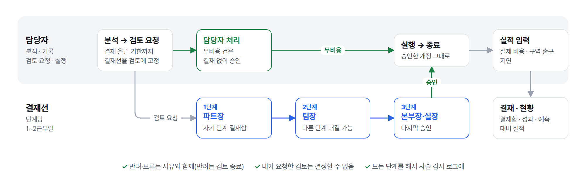
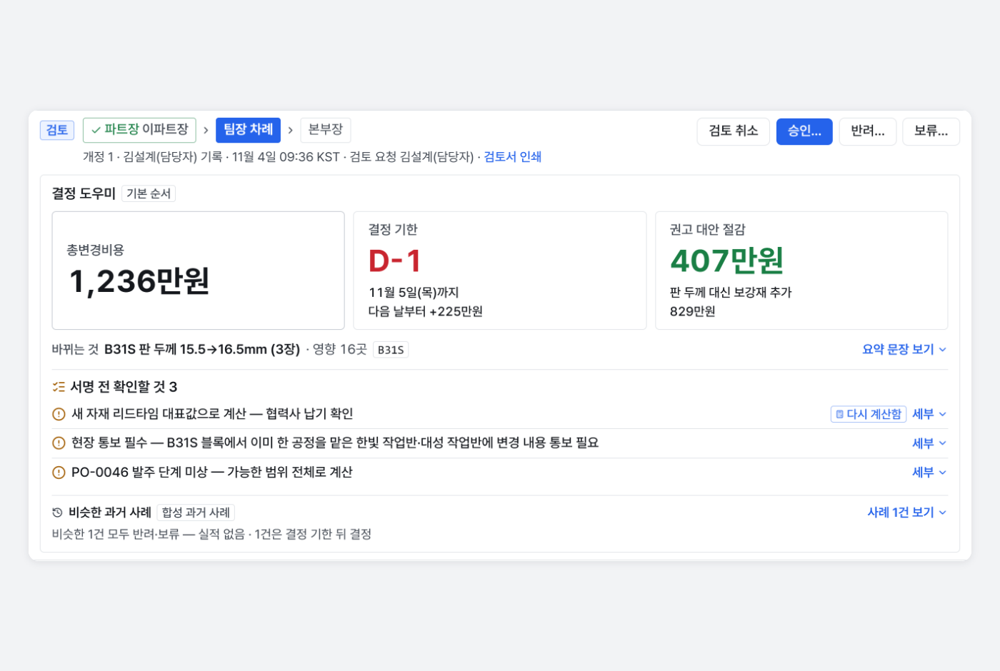

# Ripple 기능과 역할

README에서 줄인 기능 전체 목록, 역할별 사용 흐름, 결정 도우미, 시연 배포 설정을 모은 문서입니다. 화면 쓰는 법은 [사용 가이드](guide.md)에 있습니다.

## 기능 전체

| 기능 | 설명 |
|---|---|
| **영⁠향 전⁠파** | 변경 연산 8종 × 규칙 15개, 모든 영향에 근거 경로. 가장 심각한 영향까지의 주요 경로를 지도에서 강조 |
| **3⁠D 배⁠치** | 선체 배치 기준으로 바꾸는 부재와 영향 블록 위치를 3D로, 탑재 선행 관계 화살표·용접 이음면·물결 전파, 영향 목록에서 블록으로 이동(열 때만 불러옴) |
| **상⁠태 추⁠정·갱⁠신** | 발주·블록 단계를 근거로 추정(모르면 '판단 불가'), 현장 상태를 화면에서 확인·수정, 바뀌는 시트만 올려 갱신 |
| **비⁠용 · 발⁠주 조⁠치** | 확정일 단계별 비용 줄을 대표값과 범위로, 블록 재작업은 블록 난이도(형상·의장품·전장품)를 반영하고 직영·작업반(사내 협력사) 몫으로 나눔, 도장 뒤 재작업 고정 항목, 이미 발주한 품목마다 변경·취소·재발주·재고 전용·보류 |
| **일⁠정** | CPM 기준 구역 출구·인도 **예상** 지연, 자재가 늦게 오면(리드타임 범위 끝)을 따로 표시, 외자재 규격은 새 발주 리드타임에 운송 일수(항공 10일·선박 30일, 운송 방식이 비면 선박 가정), 납기 지연 의장품의 후행 설치 비교, 지연 파급 비용(가정, 총액 밖) |
| **인⁠도 임⁠박 띠** | 요청안이 인도를 늦추면 핵심 수치 위와 대안 탭 맨 위에 '인도 임박' 띠(인도·구역 출구 지연을 먼저 보라는 안내와 늦어지는 일수). 표시만 하고 대안 순위·금액은 바꾸지 않음 |
| **확⁠정 시⁠점 · 대⁠안** | 60일 추가손실 곡선, 결정 기한(D-n, 추가손실 0인 마지막 날)과 '확정일을 그날로' 단추(결정 기한이 주말이면 앞 금요일), 발주 보류 권고(결재 기간과 견줌), 판 두께·강종·보강재 대안과 예비 강도 비교 |
| **사⁠전 점⁠검** | 설치 시점 · 관통부 정합 · 블록 경계 연결 · 분야 간 도면 · 새 스풀 서포트 · 현장 공유 6규칙을 연결 지도로 짚음(3D 형상 검사 아님), 지도에 정보가 없으면 '점검 불가', 같은 유형 합성 NCR 건수, 판정·금액에는 넣지 않음 |
| **할 일 · 가⁠정 계⁠산** | 보류 적용·후행 설치를 눌러 다시 계산하고 바뀐 점(판정·비용·지연)을 견줌, 현장 상태 확인·수정 |
| **변⁠경 원⁠인** | 선주 요청이면 늘어난 인도 지연을 지체상금 대신 인도일 조정으로, 협력사 대금 조정 기한(하도급법 제16조) 안내 |
| **AI 비⁠서 · 문⁠서⁠로 넣⁠기** | 현장 표현 그대로 적은 문장이나 설계변경 문서를 넣으면 항목별 확인표 → 분석, 애매하면 되묻기, 협력사·작업반 알림 초안 |
| **엑⁠셀 가⁠져⁠오⁠기** | 지정 양식과 흔한 변형, 열 자동 매핑·기억, 데이터 칸 병합은 왼쪽 위 값으로 채워 읽기, 규격 시트의 원산지 구분·운송 방식, 품질 리포트, 지도 전환 |
| **기⁠록 · 결⁠재** | 바뀌지 않는 개정 → 검토 요청 → 결재선(파트장 → 팀장 → 본부장·실장, 팀장 전결) 승인·반려·보류 → 실행 → 종료, 무비용 건은 담당자 처리, 결재 올릴 기한(단계당 1~2근무일, 주말 제외), 해시 사슬 감사 로그, 통보 기록 |
| **결⁠정 도⁠우⁠미(결⁠재⁠자)** | 결재 띠의 세 줄 요약(바뀌는 것·결정 지연 시·권고) · 서명 전 확인할 것(AI는 고르기만) · 더 저렴한 대안 권고 · 비슷한 과거 사례(시연용 합성, 오차 통계 안 씀) |
| **엑⁠셀 내⁠보⁠내⁠기** | 상세의 분석 결과(요약 · 영향 목록 · 비용 근거 · 가정값 · 확정 시점 곡선 · 대안 비교)와 결재자의 결재 대장(결재함 · 결재선 · 승인한 단계 · 남은 결재 올릴 기한 · 현황)을 엑셀로. 숫자는 화면과 같은 결과 값 그대로 |
| **결⁠재·현⁠황(결⁠재⁠자)** | 자기 결재 단계의 결재함(팀장에게는 전결 가능 묶음) · 현황 · 성과(단계별 처리 시간·무비용 담당자 처리 수·피한 추가손실) · 예측 대비 실적 · 반복 유형(합성 NCR), 인쇄·PDF. 공개 시연 배포 전용 **합성 시연 기록**(`RIPPLE_DEMO_SEED`) — 합성 모드에서 지난 24일의 결재·실적을 채우고 실시간 세계에서는 **한국 시간 날마다 자동으로 새로 채움**(옛 기록은 보관), 숫자는 엔진·숨긴 모델 값 |
| **로⁠그⁠인 · 구⁠성⁠원** | 팀장이 발급한 계정(서버 세션·HttpOnly 쿠키·실패 제한), 역할 담당자·파트장·팀장·본부장, 구성원 추가·역할·사용 중지·삭제(나·고정 계정·마지막 팀장은 지울 수 없음, 기록의 이름은 남고 지운 아이디는 다시 쓰지 않음), 시연 배포 전용 빠른 로그인(고정 계정 잠금) |
| **시⁠연** | 위 막대 단추로 시나리오 3개(할 일로 바뀌는 영향 지도 · 말로 넣어 분석하기 · 더 저렴한 대안 찾기)를 화면이 스스로 진행, 분석·가정 계산·되돌리기만 해 기록은 남지 않음, Esc로 멈춤 |
| **소⁠개 화⁠면** | B2B 합니다체 소개와 결정 기한 중심 첫 문장, 실제 업무 화면 그림으로 담당자가 먼저 보는 순서(결정 기한 · 영향 지도 · 대안 · 팀장 결재 · AI 비서 · 운영 조건)를 따라감, 그림 속 숫자와 예시는 엔진 결과 |
| **업⁠무 화⁠면** | 목록 · 상세 · AI 비서(열고 닫기), 상세 첫 줄은 결정 기한(두 칸 폭, 하루 늦으면 늘어나는 금액의 작은 곡선, 결재 올릴 기한) · 이미 발주된 품목 · 총변경비용 · 구역 출구 예상 최대 지연, 용어 설명(ⓘ), 기준일 = 한국 시간 오늘, 1440~375px, 밝게·어둡게, 명령 팔레트(Ctrl+K) |

## 누가 어떻게 쓰나

담당자는 분석하고 검토를 요청하고, **결재선**(파트장 → 팀장 → 본부장·실장)이 차례로 결정 도우미와 그 개정의 분석 근거를 보며 결재합니다. 모든 단계는 바꿀 수 없는 해시 사슬 감사 로그에 남습니다([기록·결재 명세](records.md)).

<picture>
  <source media="(prefers-color-scheme: dark)" srcset="images/diagrams/approval-dark.png" />
  
</picture>

| 역할 | 들어가면 | 하는 일 |
|---|---|---|
| **담⁠당⁠자** | 업무 화면(설계변경 목록 · 상세 · AI 비서) | 분석(문장 · 문서로 넣기 확인표), 검토 요청(결재 올릴 기한 안내, 확인 창에서 기록까지 한 번에), 무비용 담당자 처리, 실행·종료, 실적 입력, 판단이 걸린 상태 확인·갱신, 통보 기록 |
| **파⁠트⁠장 · 본⁠부⁠장** | 결재·현황(자기 결재 단계 결재함 · 현황 · 성과) | 결재선 1단계(파트장)·3단계(본부장·실장)의 승인·반려·보류(사유 기록), 결정 도우미, 감사 로그 확인, 결재 대장 엑셀·인쇄 |
| **팀⁠장** | 결재·현황(결재함 · 현황 · 성과 · 관리) | 결재선 2단계 결재와 파트장·본부장 단계 **전결**(감사 기록에 전결과 원래 단계), 파트장·본부장과 같은 결재·현황 일, 구성원 관리·지도 전환·엑셀 가져오기·AI 호출 기록 |

- **결재선**: 추가 비용 건은 파트장 → 팀장 → 본부장·실장이 차례로 승인합니다(중형 조선소 현직자 서면 답변의 관례 — 결재 라인별 1~2일). 반려는 어느 단계에서든 검토를 끝내고, 보류는 그 단계에서 이어집니다. 결재선은 금액과 무관하고, 검토를 요청할 때 그 검토에 고정합니다.
- **무비용 담당자 처리**: 비용 줄이 도면 개정뿐이고 판정이 승인 가능인 개정은 담당자가 결재 없이 승인으로 처리합니다(합성 설계변경 300건 중 22건). 내가 요청한 검토는 어느 단계에서도 결정할 수 없습니다.
- **결재 올릴 기한**: 결정 기한까지 결재가 끝나려면 언제 올려야 하는지 — 남은 단계 × 단계당 2근무일(대표)을 결정 기한에서 거꾸로 센 마지막 근무일이고, 단계당 1근무일로 결재될 때의 날짜를 함께 보입니다. 이미 지났으면 '지금부터 결재해도 결정 가능일은 ○월 ○일 — 그날 추가손실 ○원'으로 알립니다. 주말만 빼고 공휴일은 보지 않습니다.
- **주말 결정 기한**: 결정 기한이 토·일이면 D-n·날짜는 그대로 두고 '확정일을 그날로' 단추가 그 앞 금요일(근무일)을 가리킵니다.

**결정 도우미**는 결재자가 결재 띠에서 바로 판단하도록 돕는 카드입니다. 진행 중 검토의 기록 본문(그 개정의 엔진 결과)에서 읽을 때 만들고 저장하지 않습니다([결정 도우미 명세](records.md#13-결정-도우미-계약-1310-ripplebrief)).

- **세 줄 요약** — 바뀌는 내용 → 결정이 늦어지면 무엇을 잃나 → 권고. 권고는 규칙 우선순위로 고정합니다(더 저렴한 충족 대안 → 보류 → 후행 설치 → 판정). 더 저렴한 대안의 차액은 상세 대안 탭과 같은 공식입니다.
- **서명 전 확인할 것**(최대 3개) — 판단이 기댄 가정·추정 상태와 사전 점검 항목, '틀리면 무엇이 달라지나'. 숫자는 엔진이 그 가정을 바꿔 이미 계산해 둔 값만 쓰고, **AI는 후보 중 고르고 순서만** 정합니다(합성 데이터 기록만, 실패하면 규칙 순서).
- **비슷한 과거 사례** — 같은 변경 종류 중 블록·구역·배관 계통·목적·크기가 가까운 3건. 실제 결재 이력이 없어 **시연용 합성 과거 사례**(숨긴 실제 비용 모델의 실적)로 만들고 늘 '합성 과거 사례'로 표시합니다. 요약은 건수와 사실만 쓰고 오차 통계는 쓰지 않습니다([합성 과거 사례](records.md#합성-과거-사례)).
- 글 속 숫자는 모두 기록 본문 값인지 서버가 검사하고, 도우미를 불러오지 못해도 **결재 단추는 그대로** 쓸 수 있습니다.

**시연 배포**([서비스](operations.md#서비스))
- **빠른 로그인**(`RIPPLE_QUICK_LOGIN=on`) — 로그인 화면에 '담당자로 들어가기'·'파트장으로 들어가기' 단추 둘만 보입니다. 켜져 있는 동안 아이디 로그인은 없고, 고정 계정(김설계·이파트장·박팀장·최본부장)은 구성원 관리에서 잠깁니다. 그 주소에 들어온 누구나 결재자가 되므로 **합성 데이터 시연에서만** 켭니다.
- **합성 시연 기록**(`RIPPLE_DEMO_SEED`) — 결재·현황이 비어 보이지 않게 결재선 단계가 섞인 지난 기록을 업무 경로 그대로 채웁니다. 팀장·본부장 단계는 이 기록과 결재선 진행 표시로 보입니다.
- **시연 합성 지도**(`RIPPLE_SYNTHETIC_MAP=demo`) — 기본 합성 지도에 블록 사이 탑재 선후행(이중저 → 횡격벽·종격벽·선측 → 갑판)만 더한 지도입니다. 부재·발주·설계변경 300건은 기본 지도와 같고, 아래 실제 예시·화면 그림과 시연 영상의 숫자는 이 지도 기준입니다. 평가 관문과 측정된 결과는 기본 지도로 잽니다([데이터](data.md)).
